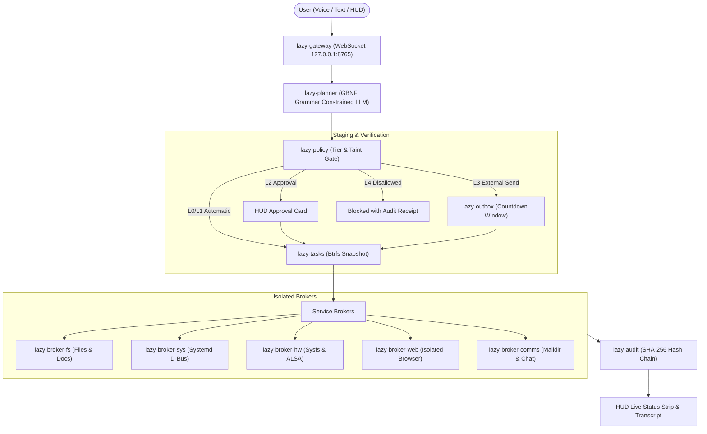
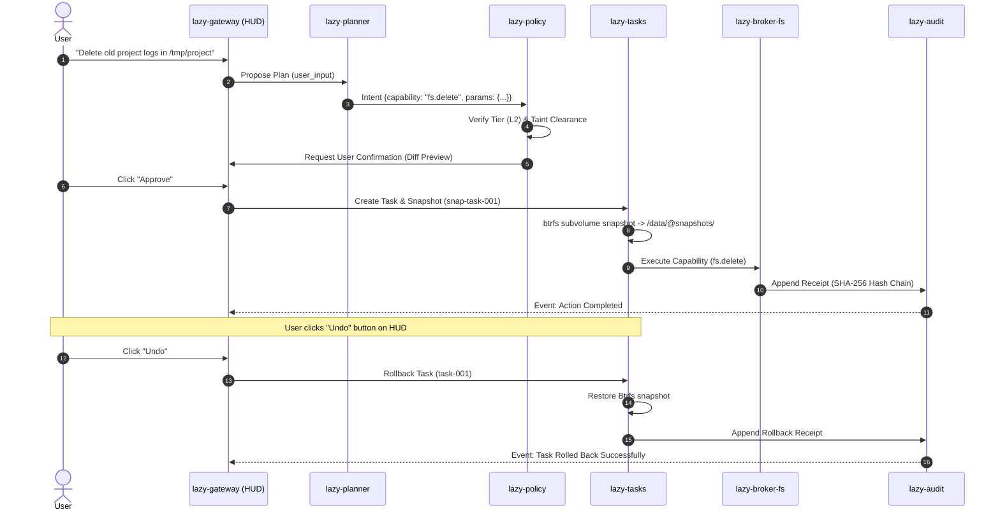

# Lazy OS System Architecture Specification

## 1. Overview and Core Philosophy
Lazy OS is an application-specific operating system prototype designed for university Operating Systems evaluation. It transforms natural user intent into audited, sandboxed, and reversible operating system actions. Trust is earned through cryptographic receipts (hash-chained audit logs), transactional rollbacks (persistent Btrfs storage with instant undo), and strict separation of privilege.

> [!NOTE]
> **Implementation Realities (Honest Labelling per V2.B3)**:
> - **Booted OS Prototype:** Operates on a Linux 6.8 kernel paired with a custom-assembled Busybox rootfs and a GPT partitioned virtual disk with real persistent Btrfs storage on `/dev/vda3`.
> - **Yocto Metadata:** Complete Yocto Project Scarthgap recipes and layer definitions exist in `yocto/meta-lazy/` and `yocto/kas/`; full native compilation requires a dedicated build host (see `docs/BUILD_ENV_PLAN.md`).
> - **In-Guest Intelligence:** Currently runs a heuristic rule-based planner in guest; full `SmolLM2-360M` neural inference runs via an optional host LLM bridge.

---

## 2. Frozen Invariants (Rules F1 to F9)
- **Rule F1**: The planner proposes; policy and brokers decide and execute.
- **Rule F2**: No free-form shell. Only registered capabilities. Code runs only in transient sandboxed units (`systemd-run` with resource and filesystem limits).
- **Rule F3**: Web, mail, feed and document text is data, never instructions.
- **Rule F4**: Credentials are never visible to the planner; access controlled via Linux `SO_PEERCRED`.
- **Rule F5**: Every task is a cancellable job with a checkpoint snapshot after each step.
- **Rule F6**: Tier L4 operations (modifying policy, broker internals, cryptographic keys, audit logs) are hard-coded forbidden.
- **Rule F7**: Everything is audited and, where possible, undoable.
- **Rule F8**: Every external send goes through the outbox. Recipients, URLs, and destinations require taint clearance.
- **Rule F9**: The browser runs in its own isolated profile and namespace with quarantined downloads.

---

## 3. High-Level Architecture & Pipeline



---

## 4. Sequence Diagram: Command Execution & Transactional Undo



---

## 5. Storage Layout & Filesystem Architecture

The disk partition layout is defined in [`yocto/meta-lazy/wic/lazy-disk.wks`](file:///c:/Users/len/OS/yocto/meta-lazy/wic/lazy-disk.wks):

```
+-------------------------------------------------------------------------------+
| Partition 1: EFI System Partition (/boot/efi, 64 MB, vfat, systemd-boot)      |
+-------------------------------------------------------------------------------+
| Partition 2: Immutable Rootfs (/, 38 MB, SquashFS, strictly read-only)        |
+-------------------------------------------------------------------------------+
| Partition 3: Writable Data Volume (/data, Btrfs, COW, subvolumes)              |
|   ├── @home        (Persistent user space: /home/user)                        |
|   ├── @snapshots   (Zero-copy COW task snapshots: /data/@snapshots)           |
|   ├── @etc_upper   (OverlayFS upper directory for /etc)                       |
|   ├── @etc_work    (OverlayFS work directory for /etc)                        |
|   ├── @var_upper   (OverlayFS upper directory for /var)                       |
|   └── @var_work    (OverlayFS work directory for /var)                        |
+-------------------------------------------------------------------------------+
```

---

## 6. Microservices & Sandboxing Matrix

Every Lazy OS service runs as an independent systemd service unit under a dedicated unprivileged user:

| Service Unit | Dedicated User | Network Access | Memory Max | CPU Weight | Sandboxing Directives |
|---|---|---|---|---|---|
| `lazy-gateway.service` | `lazy-gw` | `AF_UNIX`, `AF_INET` | 256M | 400 | `ProtectSystem=strict`, `NoNewPrivileges=yes`, `PrivateTmp=yes` |
| `lazy-planner.service` | `lazy-plan` | Strictly `AF_UNIX` | 512M | 400 | Unprivileged, no network, no shell, memory locked |
| `lazy-llm.service` | `lazy-llm` | Strictly `AF_UNIX` | 1024M | 500 | `LimitMEMLOCK=infinity`, `CPUAffinity=0-1`, warm resident |
| `lazy-policy.service` | `lazy-pol` | Strictly `AF_UNIX` | 256M | 100 | Policy rules validation, capability manifests loader |
| `lazy-tasks.service` | `lazy-task` | Strictly `AF_UNIX` | 256M | 100 | Btrfs subvolume snapshot manager and rollback engine |
| `lazy-broker-fs.service` | `lazy-brk-fs` | Strictly `AF_UNIX` | 256M | 100 | Sandboxed filesystem operations, markdown/docx authoring |
| `lazy-broker-sys.service` | `lazy-brk-sys`| Strictly `AF_UNIX` | 256M | 100 | Systemd D-Bus interface, process inspector, service control |
| `lazy-broker-hw.service` | `lazy-brk-hw` | Strictly `AF_UNIX` | 256M | 100 | Sysfs backlight, rfkill, CPUFreq governors, ALSA audio |
| `lazy-broker-web.service`| `lazy-brk-web`| `AF_UNIX`, `AF_INET` | 256M | 100 | Isolated browser driver, quarantine manager (0600 permissions) |
| `lazy-broker-comms.service`| `lazy-brk-comms`| `AF_UNIX`, `AF_INET` | 256M | 100 | Maildir RFC 822 parser, SMTP sink, local chat service |
| `lazy-secrets.service` | `lazy-secrets`| Strictly `AF_UNIX` | 128M | 100 | Vault protected by Linux `SO_PEERCRED` checks |
| `lazy-outbox.service` | `lazy-outbox` | Strictly `AF_UNIX` | 128M | 100 | Staged external send queue, countdown undo windows |
| `lazy-fetcher.service` | `lazy-fetch` | `AF_UNIX`, `AF_INET` | 256M | 50 | Sandboxed feed fetcher; Rule F3 quoted text extractor |
| `lazy-routines.service`| `lazy-rout` | Strictly `AF_UNIX` | 256M | 50 | Morning briefing generator, TF-IDF niche ranker |
| `lazy-audit.service` | `lazy-audit` | Strictly `AF_UNIX` | 128M | 100 | SHA-256 hash-chained append-only receipt ledger |

---

## 7. IPC Protocol (JSON-RPC 2.0 over Unix Domain Sockets)
All inter-service calls use JSON-RPC 2.0 over individual Unix domain sockets located in `/run/lazy/`:
- `request`: `{"jsonrpc": "2.0", "id": "<uuid>", "method": "<capability>", "params": {...}}`
- `response`: `{"jsonrpc": "2.0", "id": "<uuid>", "result": {"status": "ok", ...}}`
- `error`: `{"jsonrpc": "2.0", "id": "<uuid>", "error": {"code": -32600, "message": "..."}}`
